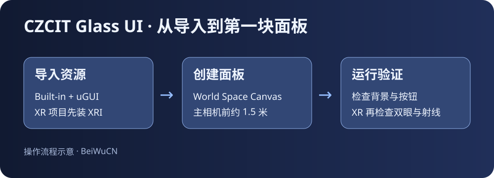
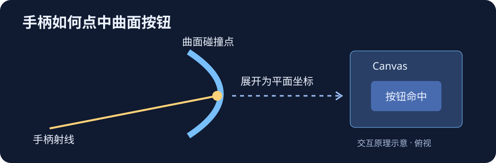

# CZCIT Glass UI 26.11.17

**作者：BeiWuCN** · Unity 2022.3 · Built-in Render Pipeline · uGUI

CZCIT Glass UI 提供可放进三维场景的磨砂玻璃面板，以及可选的 XR 曲面布局、射线命中和滑条交互。发布文件是 `CZCIT-GlassUI-26.11.17.unitypackage`，通过 Unity 的资源导入菜单安装。



## 1. 选好导入方式

| 你的项目 | 导入前准备 | 导入时选择 |
| --- | --- | --- |
| 普通桌面项目 | Unity 2022.3、Built-in、uGUI | 取消勾选 `Runtime/XR` 整个文件夹，其余资源保留 |
| VR 项目 | 在 Package Manager 安装 XR Interaction Toolkit 2.6.4，按目标设备配置 XR | 完整导入 |

1. 打开目标项目，选择 **Assets → Import Package → Custom Package…**。
2. 选中 `CZCIT-GlassUI-26.11.17.unitypackage`。在导入列表内按上表选择。
3. 等 Unity 编译完毕，查看 Console。首次试用建议从一个空白 Built-in 场景开始。

包内资源位于 `Assets/CZCIT GlassUI`。在已有项目升级时，先让 Unity 在原路径导入，避免在另一个目录再放一套同名脚本和程序集。

## 2. 五分钟做出第一块面板

1. 确认场景有一台启用的相机，Tag 是 **MainCamera**。在相机前放一个颜色鲜明的立方体或柱子，方便观察背景变化。
2. 选择 **GameObject → UI → CZCIT Frosted Glass Panel**。工具会创建 World Space Canvas，默认尺寸为 900 × 500，放在主相机前约 1.5 米，并给主相机添加背景复制组件。
3. 展开 Canvas，选中子物体 **Panel**。它的 Image 使用 `Materials/FrostedPanel`。进入 Play Mode，移动玻璃背后的物体，观察玻璃内外的差异。
4. 需要按钮时，在 Canvas 下添加 uGUI Button，通过 **Button → On Click()** 绑定自己的方法。给桌面场景配置一个 EventSystem，再用鼠标点击验证。背景 Panel 默认关闭 Raycast Target，避免挡住按钮。

### 调出自己的玻璃质感

先复制一份 `FrostedPanel` 材质，再把复制品拖到 Image 的 Material 上。这样几个面板可以有各自的比例和质感。

| 参数 | 怎么调 |
| --- | --- |
| `_Blur` | 控制背景模糊，先用背后有轮廓的物体观察变化 |
| `_Frost` | 调整磨砂强度，背景太抢眼时先调这个 |
| `_Radius` | 调整圆角，窄条按钮通常需要单独调 |
| `_Aspect` | 填面板宽 ÷ 高。例如 900 × 500 填 1.8 |

## 3. 给 XR 面板加曲率

先把平面 Canvas 跑通。确认 XR EventSystem 使用 `XRUIInputModule`，手柄射线支持 UI 交互，且 Canvas 的 World Camera 指向 XR 相机。然后在初始化代码中，对要弯曲的画布调用：

```csharp
CZCIT.GlassUI.CurvedGlassLayout.Apply(canvas, 1600, "Panel");
```

`canvas` 是当前世界空间画布，例子里的 `Panel` 对应示例面板名。先用示例值跑通，再按场景比例调曲率。在 XR 中分别指向中间和两侧的按钮：能看到悬停反馈，再逐个按下确认事件触发。



曲面网格负责显示。射线组件求出曲面命中位置，再映射回平面的 UI 坐标，所以按钮仍按原有的 uGUI 事件方式接业务。两张配图都是操作或原理示意。

## 4. 常见问题

| 现象 | 从哪里查 |
| --- | --- |
| 导入报找不到 `UnityEngine.XR.Interaction.Toolkit` | 桌面版确认未导入 `Runtime/XR`。XR 版确认先安装 XRI 2.6.4，再等 Package Manager 和 Unity 编译完成。 |
| 菜单项没出现 | 先解决 Console 里的编译错误，再到 **GameObject → UI** 查找。 |
| 面板呈粉色 | 到 **Project Settings → Graphics** 检查渲染管线。随包 shader 面向 Built-in。URP/HDRP 项目需要适配材质和背景采集。 |
| 面板有颜色，背后却没有动态变化 | 检查相机上的 `GlassSceneBackground`、面板材质以及物体是否位于玻璃后方。双眼捕获不可用时会显示材质回退。 |
| 能看到按钮，但点不动 | 桌面检查 EventSystem 和 GraphicRaycaster。XR 检查 XRUIInputModule、手柄的 UI 射线、World Camera 和曲面射线组件。 |
| 不同相机或面板的背景相互覆盖 | 背景纹理使用全局 shader 参数。先在一个场景只保留一套采集组件，确认效果后再规划多相机方案。 |

## 5. 接进自己的项目

建议把玻璃面板和按钮做成自己的 Prefab，再从 Inspector 绑定业务。独立包提供玻璃 shader、背景采集、曲面交互及基础动效。在自己的脚本中绑定按钮事件、切换内容并接入场景逻辑。

通过 `CZCIT.GlassUI.GlassUiMotion.For(panelGameObject)` 可以获取面板动效对象，再用 `SetVisible(bool)` 控制显隐。XR 曲面滑条可以用 `onValueChanged` 做实时预览，用 `onInteractionCompleted` 在操作结束时保存设置。

兼容范围以 **Unity 2022.3 + Built-in + uGUI** 为起点。对于新 Unity 版本、不同渲染管线或头显组合，先在空场景验证材质、鼠标或手柄输入和左右眼效果。

## 6. 上线前的验收清单

### 外观与布局

- **确认玻璃背后有可辨认的物体。** 用两种颜色的物体穿过面板背面。面板内的轮廓应随物体移动，面板外仍保持原场景效果。
- **每种宽高比使用独立材质。** 横条、方形卡片和长面板分别复制材质，再设置自己的 `_Aspect`。如果改一个面板时另一个也变了，检查两个 Image 是否还引用同一份材质。
- **在相机移动后重看一次。** 确认面板的位置、朝向与 World Camera 设置适合实际视角。

### 鼠标与手柄

- **先验证一个按钮。** 给 Button 的点击事件绑定一个能立即看出变化的操作，例如切换子物体的显隐。确认普通点击成功，再加曲率或更多页面。
- **从中间测到边缘。** XR 面板至少测试中央、左缘和右缘的控件。悬停反馈与点击结果应落在同一个控件上。
- **检查隐藏状态。** 如果隐藏面板仍然挡住操作，检查它的 CanvasGroup，关闭 **Blocks Raycasts** 和 **Interactable**，恢复显示时再按需要开启。
- **在目标头显中确认左右眼。** 编辑器能编译、桌面能点，只完成了前两项检查。交付 XR 内容前，还应检查双眼背景、遮挡、手柄点击和页面切换。

### 分享与升级

- 分发时提供 **unitypackage**；图文教程以目录为单位分享，保留 `README.md` 和 `images/` 的相对位置。
- 升级前保存工程改动。在 Unity 导入列表里核对目标目录为 **Assets/CZCIT GlassUI**，并确认本地自定义材质与 Prefab 放在自己的业务目录。

## 7. 选择平面、曲面和控件布局

**只想用平面？直接运行创建面板的菜单，跳过第 3 节。** 生成的是平面 World Space Canvas，磨砂玻璃材质照常工作。纯桌面项目保留 GraphicRaycaster 和 EventSystem。平面 XR 项目使用普通 TrackedDeviceGraphicRaycaster 和 XRUIInputModule。

如果已经对画布调用过 Apply，可以调用 `CZCIT.GlassUI.CurvedGlassLayout.ApplyFlat(canvas)`。**切回平面 XR 后，在 Inspector 确认普通 TrackedDeviceGraphicRaycaster 已启用或重新添加。** Apply 可能禁用或移除过它，ApplyFlat 只负责关闭曲面效果和曲面射线组件。

### 按钮和文字应该放在哪里？

```text
MenuCanvas             ← World Space Canvas
└─ Panel               ← Image，玻璃背景，Raycast Target 关闭
   ├─ Title            ← UI Text 或 TextMeshPro - Text (UI)
   ├─ Start            ← Button + Image，Image 保留 Raycast Target
   │  └─ Label         ← UI 文字，Raycast Target 关闭
   └─ Options          ← Button + Image
      └─ Label         ← UI 文字
```

**先按平面布局，生成控件后再对最外层 Canvas 调用 Apply。** 当前实现会遍历当时已有的子级 uGUI Graphic，在每个图形上挂载 CurvedGraphicMesh。背景、按钮底图和文字分别有自己的网格。它们使用同一个 Canvas 坐标系和曲率，别给每个按钮单独弯一次。若运行中实例化新按钮或新页面，等布局更新后，对同一 Canvas 再调用 Apply，让新 Graphic 也获得效果。

| 看到的现象 | 检查方法 |
| --- | --- |
| 背景弯了，按钮还是平的 | 检查按钮 Image 是否在传入的 Canvas 下，以及它是否在 Apply 之后才创建。 |
| 按钮弯了，文字还是平的 | 检查文字对象自己的 CurvedGraphicMesh 和 root。使用 Canvas 下的 UI 文字。3D TextMeshPro、SpriteRenderer、MeshRenderer 都不属于这次 Graphic 遍历。 |
| 中央文字看起来几乎是平的 | 曲率沿横向变化。短文字靠近中心时弧度很小，把一个宽 Image 放在左右两侧，从斜角观察会更明显。 |
| 边缘看起来弯，但点不中 | 检查 CurvedGlassRaycaster 与网格半径是否一致，Canvas 的相机是否正确。桌面鼠标菜单先用平面验证。 |

## 8. 做一个能上下拖动的主菜单

### 初级：连续滚动列表

如果需求是**上下浏览很多条按钮**，从 Unity 的 **GameObject → UI → Scroll View** 开始。在 Scroll Rect 中只开启 **Vertical**，把按钮放进 `Viewport/Content`，给 Content 加 Vertical Layout Group，再用 Content Size Fitter 的 **Vertical Fit → Preferred Size** 让内容随条目数量增长。Viewport 负责裁剪。先用平面版确认鼠标滚轮和拖拽都能移动，项目有 XR 时再单独验证设备输入与曲面裁剪。

### 中级：一次拖动只切一页

如果需求是**上拉切下一页，下拉切上一页**，用一个专用拖拽柄控制分页。页面内容与拖拽柄分开摆放，这样按钮的正常点击不会被拖拽柄抢走。

1. 在 Canvas 下创建 `Pages`，每个页面根节点加一个 **CanvasGroup**。页面放在同一个锚点位置。
2. 在 Pages 外创建一块顶部或底部的 **Drag Handle**，给它加 Image，勾选 **Raycast Target**。
3. 新建 `VerticalPageDrag.cs`，粘贴下面代码，挂到 Drag Handle。按顺序把页面的 CanvasGroup 拖进 **Pages** 数组。
4. 先在平面菜单测试。**拖不到 80 屏幕像素就回弹，超过阈值且有下一页才切换。**

```csharp
using System.Collections;
using UnityEngine;
using UnityEngine.EventSystems;

public sealed class VerticalPageDrag : MonoBehaviour,
    IBeginDragHandler, IDragHandler, IEndDragHandler
{
    [SerializeField] private CanvasGroup[] pages;
    [SerializeField] private float thresholdPixels = 80f;
    [SerializeField] private float previewTravel = 48f;
    private int index;
    private int pointerId;
    private bool dragging;
    private bool settling;
    private float startY;
    private Vector2 rest;

    private void Start()
    {
        if (pages == null || pages.Length == 0) return;
        for (int i = 0; i < pages.Length; i++) Show(pages[i], i == index);
    }

    public void OnBeginDrag(PointerEventData e)
    {
        if (dragging || settling || pages == null || pages.Length == 0) return;
        dragging = true;
        // 记住发起拖动的指针，避免另一个指针抢走操作。
        pointerId = e.pointerId;
        startY = e.pressPosition.y;
        rest = ((RectTransform)pages[index].transform).anchoredPosition;
        pages[index].interactable = pages[index].blocksRaycasts = false;
    }

    public void OnDrag(PointerEventData e)
    {
        if (!dragging || e.pointerId != pointerId) return;
        float y = Mathf.Clamp((e.position.y - startY) * .35f,
            -previewTravel, previewTravel);
        ((RectTransform)pages[index].transform).anchoredPosition = rest + Vector2.up * y;
    }

    public void OnEndDrag(PointerEventData e)
    {
        if (!dragging || e.pointerId != pointerId) return;
        dragging = false;
        float delta = e.position.y - startY;
        int direction = Mathf.Abs(delta) >= thresholdPixels ? (delta > 0 ? 1 : -1) : 0;
        // 把目标限制在已有页面内，第一页和最后一页不会越界。
        int target = Mathf.Clamp(index + direction, 0, pages.Length - 1);
        StartCoroutine(Settle(target));
    }

    private IEnumerator Settle(int target)
    {
        settling = true;
        CanvasGroup oldPage = pages[index];
        RectTransform rect = (RectTransform)oldPage.transform;
        Vector2 from = rect.anchoredPosition;
        bool switching = target != index;

        for (float elapsed = 0f; elapsed < .18f; elapsed += Time.unscaledDeltaTime)
        {
            float t = Mathf.SmoothStep(0f, 1f, elapsed / .18f);
            if (switching) oldPage.alpha = 1f - t;
            else rect.anchoredPosition = Vector2.Lerp(from, rest, t);
            yield return null;
        }

        rect.anchoredPosition = rest;
        Show(oldPage, false);
        index = target;
        Show(pages[index], true);
        settling = false;
    }

    private static void Show(CanvasGroup group, bool visible)
    {
        group.alpha = visible ? 1f : 0f;
        group.interactable = group.blocksRaycasts = visible;
    }
}
```

测试三次：**短拖回弹、长拖换页、在首页往回拖仍留在首页**。这个示例用屏幕像素判断方向和阈值，适合先跑通桌面。Drag Handle 保持在页面组外并保持启用，直到释放事件到达。

### 高级：曲面 XR 与双页预览

- **保留分页状态，把输入单独接进来。** 将 Begin、Update、End 改成接受拖动量的方法。鼠标继续输入屏幕像素。XR 在抓取时记录手柄世界位置，更新时用 Canvas 的 `InverseTransformPoint` 转为面板局部坐标，再取 `current.y - start.y`。该曲面沿水平方向弯曲，垂直位移可以直接用面板局部 Y。阈值随 Canvas 比例一起定，用头显实测手感。
- **先锁定本次拖动的手柄。** 第二只手的输入忽略。松开时提交，手柄失联、菜单关闭或场景卸载时取消，恢复当前页位置、透明度和点击状态。用按钮触发翻页时也走同一套状态逻辑。
- **下一页可以提前出现。** 拖到一半时让目标页跟着移动与淡入，但保持 **Interactable 和 Blocks Raycasts 关闭**。释放未达阈值时，两页一起回到初态。确认换页后再打开新页的输入。
- **曲率以最外层 Canvas 为基准。** 上下切换只移动页面容器。动态创建新页后补用一次曲面布局，再检查文字、按钮和射线。要移动整张面板时移动 Canvas 根对象；若动画改变子控件相对根的位置，检查网格是否需要调用 `SetVerticesDirty()` 更新。
- **整块菜单抓取与页内翻页分开。** 包内的 MenuGrabHandle 面向宿主提供的 IGlassDragTarget。做分页时先用独立拖拽柄定义自己的翻页状态，再按输入设计选择射线拖动或手柄位移。

最终至少在设备上检查 **短拖回弹、跨页、到边界、第二只手误触、关闭菜单后重新打开**。这几项比单独播放一次切页动画更容易发现输入交接的问题。

## 9. 通过代码切换曲率

将以下方法放入菜单控制器。把 Canvas 拖到 Inspector 对应字段，再把方法绑定到按钮的 **On Click()**。这段示例用于 XRI 项目。

```csharp
using CZCIT.GlassUI;
using UnityEngine;
using UnityEngine.XR.Interaction.Toolkit.UI;

public sealed class GlassLayoutButtons : MonoBehaviour
{
    [SerializeField] private Canvas canvas;

    public void Curve() => CurvedGlassLayout.Apply(canvas, 1600f, "Panel");

    public void Flatten()
    {
        // 去掉曲面网格和曲面射线，再恢复平面 XR 射线。
        CurvedGlassLayout.ApplyFlat(canvas);
        foreach (var raycaster in canvas.GetComponents<TrackedDeviceGraphicRaycaster>())
        {
            if (raycaster is CurvedGlassRaycaster) continue;
            raycaster.enabled = true;
            return;
        }
        canvas.gameObject.AddComponent<TrackedDeviceGraphicRaycaster>();
    }
}
```

按 **平面 → 曲面 → 平面** 切换，每次都点一次最外侧的按钮。靠近边缘比点击中央更容易发现显示与点击位置不一致的问题。

## 10. 把鼠标翻页扩展到手柄翻页


将第 8 节的分页逻辑拆成输入、分页状态和画面更新三部分。桌面输入用屏幕像素，XR 输入改用 **Canvas 局部位移**：

```csharp
// 抓取开始时记录 startHandWorld，拖动时读取当前手柄位置。
float startY = canvas.transform.InverseTransformPoint(startHandWorld).y;
float currentY = canvas.transform.InverseTransformPoint(hand.position).y;
float delta = currentY - startY;
float progress = Mathf.Clamp01(Mathf.Abs(delta) / threshold);
int direction = delta > 0f ? 1 : -1;
int target = Mathf.Clamp(currentPage + direction, 0, pageCount - 1);
bool commit = target != currentPage && Mathf.Abs(delta) >= threshold;
```

**threshold 需要大于 0。** Canvas 均匀缩放为 0.001 时，局部 50 单位对应约 5 厘米。拖动时用 progress 预览，松手时用 commit 决定切页或回弹。预览中关闭新页的 Blocks Raycasts，确认换页后才开启。手柄失联或菜单关闭时，取消这次拖动并恢复当前页。

### 实操：在一张曲面上放标题、按钮和图片

1. **在同一个 World Space Canvas 下摆放。** 在 Panel 下创建 UI 标题、UI Button 和 UI Image。按钮的标签放在按钮子级。图片使用 Canvas 下的 **Image**，把 Sprite 拖进 **Source Image**。不要把图片变成场景里的 SpriteRenderer，也不要把标题创建成 3D TextMeshPro。
2. **像平面 UI 一样编辑 RectTransform。** 标题锚在上方，按钮放中间，图片放到一侧。用锚点和 Anchored Position 定位，保持子控件的局部 Z 为 0，局部旋转为 0。曲率由画布统一计算，按钮两侧无需手动旋转。
3. **先摆齐，再调用 Apply。** 把最外层 Canvas 传进去。背景 Image、按钮的目标 Image、标题和标签是不同的 Graphic，各自都会获得 CurvedGraphicMesh。按钮组件本身负责事件，负责弯曲的是它的图形。
4. **只让可交互的图形接射线。** 按钮底图保留 **Raycast Target**。装饰图片、背景和标签关闭它，以免覆盖按钮。用斜视角看两侧的宽图片，再用手柄点最靠边的按钮。
5. **后加的内容也要应用曲率。** 实例化新按钮、图标或页面后，先让布局算完，再对原 Canvas 重新调用 Apply。Inspector 里选中新图形，确认 CurvedGraphicMesh 的 **Root** 是同一个 Canvas，**Radius** 与曲面射线一致。

```csharp
// imagePrefab 是 Canvas UI Image 的 Prefab，panel 是同一 Canvas 下的容器。
var image = Instantiate(imagePrefab, panel, false);

// 先完成图标定位和布局，再更新曲率。装饰图标不应挡按钮。
image.raycastTarget = false;
Canvas.ForceUpdateCanvases();
CZCIT.GlassUI.CurvedGlassLayout.Apply(canvas, 1600f, "Panel");
```

**判断是没弯，还是弯得不明显。** 窄文字靠近中央时，正面看很像平面。把宽图移到一侧，从斜角看轮廓。若偏到边缘仍完全不弯，再查控件是否属于 uGUI Graphic、是否在传入的 Canvas 下，以及是否在 Apply 之后才添加。纯平面菜单跳过 Apply。
