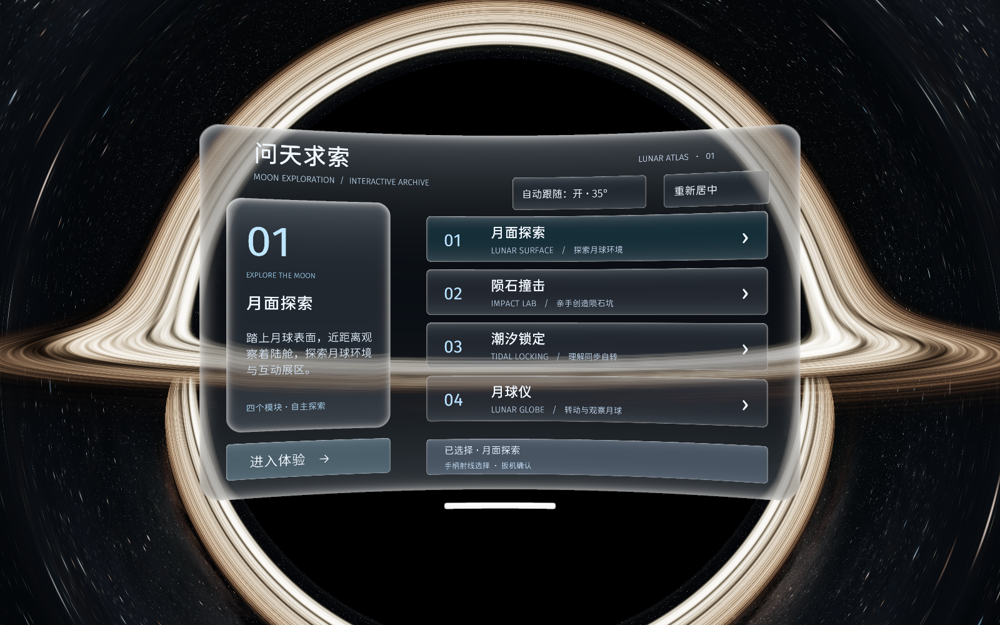
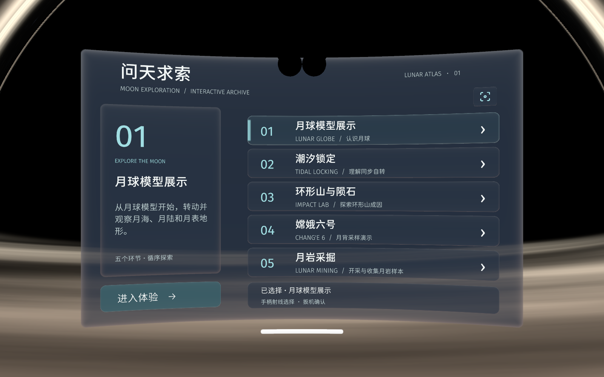

# CZCIT Glass UI

**BeiWuCN · Unity 2022.3 · Built-in Render Pipeline**

C# 组件用于搭建世界空间磨砂玻璃 UI，支持平面布局和可选的 XR 曲面交互。

- [下载 26.11.17](https://github.com/BeiWuCN/CZCIT.GlassUI/releases/tag/26.11.17)
- [图文教程和 C# 示例](Assets/CZCIT%20GlassUI/README.md)
- [Tabler Icons 第三方许可](ThirdParty/TablerIcons.txt)

在 Unity 中选择 **Assets → Import Package → Custom Package**。包会导入到 `Assets/CZCIT GlassUI/`。核心使用 uGUI，XR 扩展使用 XR Interaction Toolkit 2.6.4。磨砂玻璃效果由随包 Shader 实现。

## 效果预览

下列截图来自实际应用，展示同一套玻璃组件如何用于不同的菜单布局。可在空白场景中按教程搭建自己的面板。

**曲面主菜单**。背景、按钮与文字共享同一画布曲率。

**导航界面**。详情卡、列表、选中态与操作按钮组合在同一块世界空间画布上。
